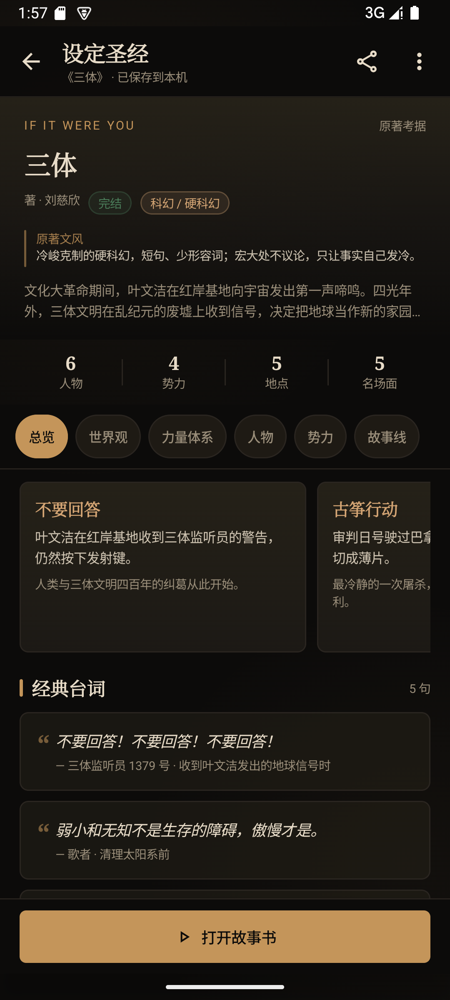
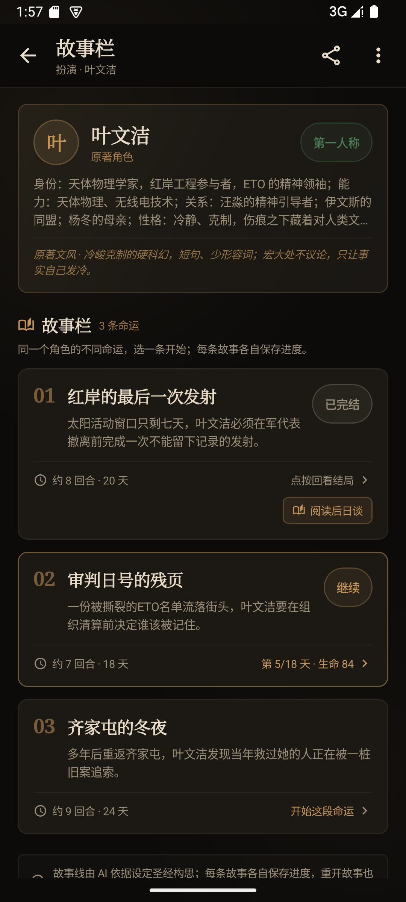
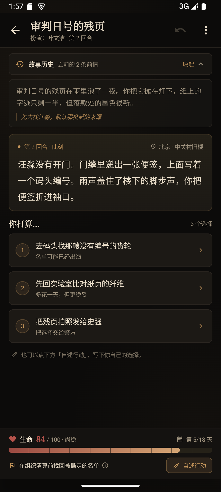
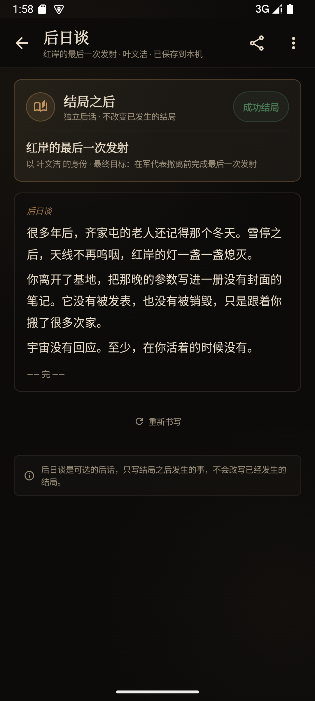

# 假如是你 · Android

> 输入一部小说，生成它的设定圣经，再以「你」为主角走进故事。

这是一个可以直接安装在手机上的单机文字冒险 App：**Kotlin + Jetpack Compose + Material 3**，
不需要本机后端，AI 请求由手机直接发往你配置的 OpenAI 兼容服务。

本项目是 [Character](https://github.com/vw0901/Character)（Next.js + FastAPI）的 Android 原生重制版。
旧存档与检索 / 设定圣经结构继续兼容；1.2.0 重做了角色故事栏与冒险界面，1.2.1 把结局页与后日谈拆成两个阶段。

- 仓库地址：<https://github.com/vw0901/Character_app>
- 当前版本：**1.2.1**（versionCode 4）
- 包名：`com.ifitwereyou.character`
- 最低系统：Android 8.0（API 26）
- 目标 SDK：Android 15（API 35）
- 技术栈：Kotlin 2.x、Jetpack Compose、Material 3、OkHttp、Kotlin Coroutines
- 安装包：构建后位于 `app/build/outputs/apk/debug/app-debug.apk`

## 界面

截图来自 Android 15（API 35）模拟器，已按 1.2.1 全部重拍。

| 书架 / 首页 | AI 设置 |
|---|---|
|  |  |

| 设定圣经 · 书封 | 设定圣经 · 原著气质 |
|---|---|
|  |  |

| 选择故事角色 | 故事栏 · 多条命运 |
|---|---|
|  |  |

| 文字冒险 · 当前回合 | 故事历史 · 展开 |
|---|---|
|  |  |

| 自述行动 · 底部弹层 | 结局页 · 故事总结 |
|---|---|
|  |  |

| 后日谈 · 独立后话 | 故事栏 · 已完结故事 |
|---|---|
|  |  |

漏洞体检与自动修补已移除：设定圣经完成后，先选择角色，再从故事栏里挑一条命运进入故事。结局与后日谈分开：结局页自动总结，后日谈由玩家从结局页或已完结故事卡按需打开。

## 这套 App 能做什么

1.2.1 把创作流程收束为更短、更「原著向」的一条线：

**检索 → 设定圣经 → 选择角色 → 故事栏（多条命运）→ 文字冒险 → 结局页 → 可选后日谈**

- **检索小说**：输入书名，可选接入 Tavily。启用后会从「基本盘」「世界观 / 人物」「名场面 / 台词」三个角度并行检索，再由模型合成一份考据资料包；未配置检索时由模型知识兜底。
- **设定圣经**：流式生成世界观、力量体系、势力、人物、时间线、未解之谜，以及地点、关键物品、名场面、经典台词、叙事文风和主题词；宽松解析 JSON 并支持重试。
- **原著味道**：每个角色的故事、结局总结与后日谈都会携带文风、主题、名场面和台词摘要，提示模型沿用原著的称呼、地名、招式与语言气质，而不是写成通用爽文。
- **角色故事栏**：选定角色后，AI 基于设定圣经一次构思 3–4 条互不相同的命运；每条都标注故事名、故事简概与估算时长（回合 / 天数），可分别开始、继续或回看结局。
- **一条命运一份存档**：同一角色的每条故事线独立保存进度，重开某条故事不会影响其他命运；旧存档里的单人故事会作为「旧日故事」继续保留。
- **文字冒险**：每轮一个场景，选项由模型生成；生命值固定满血开局，只保留一条生命条，不再显示战力 / 声望。
- **体验友好的数值**：单回合生命变化有客户端上限（常规最多 -18、濒危最多 -10，治疗最多 +12 / 濒危 +20），并提示模型在连续受伤后给出喘息、治疗或撤退选项。
- **当前回合阅读**：冒险主界面只展示本回合文本与选项，前情收进可展开 / 收起的「故事历史」；生命条、目标与天数固定在屏幕底部。
- **自述行动**：底部「自述行动」打开弹层，最多 200 字，可让 AI 润色成小说句子，也可还原原句后直接提交。
- **结局判定**：成功 / 失败由客户端规则裁定，不交给模型单独决定；每轮独立复核目标，超时有本地兜底。
- **结局页**：无论成功或失败，结局后都会自动生成一页 300–500 字的故事总结，回望关键选择、目标结果与代价；结局页只写到故事停下的一刻。
- **可选后日谈**：结局页不再自动续写后日谈；玩家可在结局页点「生成后日谈」，或从故事栏的已完结故事卡进入。后日谈单独成页、按需流式生成 500–800 字，写完才存档，可重新书写。
- **回退与重开**：最多保留 20 步快照；成功后不可回退；失败可以重开本条故事或换一条命运。
- **本地存档**：自动防抖保存、原子写入；支持导入原项目与旧版本存档，导出 JSON 仍沿用原项目的检索 / 圣经 / 冒险结构。
- **AI 配置**：内置 OpenAI、DeepSeek、Ollama、火山方舟、阿里百炼、硅基流动、Moonshot、智谱 8 个预设，
  也可以手工填写任意 OpenAI 兼容接口；支持拉取模型列表和测试连接。

### 面向手机的操作与视觉

1.0.0 做了手机化重构，1.1.0 重做设定圣经，1.2.0 重做故事栏与冒险页，1.2.1 拆出结局页与后日谈：

- **故事栏**：选角色后先看到角色卡（身份、能力、关系、原著文风）与 3–4 张故事卡，每张都有编号、故事名、简概、时长和进度状态；已完结故事在卡片底部直接提供「后日谈」入口。
- **结局页**：结局面板自动展示「结局页 · 故事总结」，与最终场景、目标结果、生命与天数一起收束；目标达成或失败共用同一套版式。
- **独立后日谈**：后日谈是单独页面，只写结局之后；从结局页或已完结故事卡进入，按需生成、流式显示，可重新书写。
- **书封式设定圣经**：顶部是小说书名、作者、连载状态、类型与原著文风，下面用「总览 / 世界观 / 力量体系 / 人物 / 势力 / 故事线」分段浏览。
- **原著气质卡片**：总览页单独展示主题词、叙事文风、名场面横滑卡片、经典台词、重要地点与关键物品。
- **当前回合聚焦**：冒险页不再铺开整段历史，只显示本回合文本与选项；前情收进顶部「故事历史」，点按展开 / 收起，新回合会自动收起。
- **底部状态坞**：生命条、数值、状态、当前天数、最终目标固定吸底；血条带平滑动画与 10 格刻度，低血量自动转红。
- **自述行动弹层**：原本占半屏的输入框收进底部弹层，主阅读区更干净；润色、还原原句、字数与错误提示都在弹层内完成。
- **目标详情**：点底部目标可查看最终目标、达成条件、时间线与故事简概，不打断阅读。
- **统一 App 顶栏**：返回键、页面标题、副标题和当前操作固定在上方，不再用悬浮齿轮遮挡内容。
- **主操作吸底**：故事栏、设定圣经、保存设置等下一步动作固定在底部，长页面也不用滑到底。
- **低频操作收进「更多」菜单**：导出、查看设定圣经、切换角色、返回书架等不再挤占首屏。
- **移动端触控尺寸**：主按钮和图标按钮至少 48dp，选项卡片、故事卡片、角色卡片、标签都有完整的点按反馈。
- **触感反馈**：选择行动、选择角色、打开故事时触发轻触感，降低误触和「没点上」的不确定感。
- **空态与引导**：没有存档时直接给出「导入 JSON 存档」入口；故事栏生成中有骨架卡，失败后就地重试。
- **键盘与安全区适配**：edge-to-edge、`imePadding`、`safeDrawingPadding`，输入行动时界面不会被键盘挡住。
- **危险操作确认**：「清除配置」会先弹出确认框，避免误删 API Key。
- **墨香与炉火视觉**：深夜书房、旧皮革书封、烛火暖光和羊皮纸文字，衬线标题 + 等宽冒险正文继续保留。

## 快速开始

### 环境

- JDK 17
- Android SDK Platform 35
- Build-Tools 35.0.0
- Android Studio（推荐）或命令行 Gradle
- 不需要 Node.js / Python / FastAPI

### 构建

```bash
cd character_app

# Windows
gradlew.bat :app:assembleDebug

# macOS / Linux
./gradlew :app:assembleDebug
```

产物：`app/build/outputs/apk/debug/app-debug.apk`

如果本机没有 `local.properties`，创建它并指向自己的 SDK：

```properties
sdk.dir=C\:\\path\\to\\Android\\Sdk
```

也可以直接用 Android Studio 打开 `character_app`，等待 Gradle Sync 后运行 `app`。

`gradle/wrapper/gradle-wrapper.properties` 默认使用腾讯云 Gradle 镜像；网络条件允许时可以换回
`https://services.gradle.org/distributions/gradle-8.9-bin.zip`。

### 安装

```bash
adb install -r app/build/outputs/apk/debug/app-debug.apk
```

## 第一次使用

1. 点首页右上角齿轮，进入 **AI 设置**。
2. 选择服务商预设，或填写任意 OpenAI 兼容接口的 **Base URL / API Key / 模型名**。
3. 点「获取模型」拉取模型列表，点「测试连接」确认连通，再点底部「保存设置」。
4. 回到书架，输入小说名（如《三体》）→ 检索 → 生成设定圣经 → 选择角色。
5. 角色故事栏会自动构思多条命运；选一条进入故事。每轮先读当前回合，再选选项，或点底部「自述行动」写下自己的做法。
6. 目标达成或失败后先读自动生成的「结局页」；想继续看结局之后，再点「生成后日谈」，或从故事栏的已完结故事卡进入后日谈。

### 本机模型地址

- 手机上的 Ollama：`http://127.0.0.1:11434/v1`
- 电脑上的 Ollama，从 Android 模拟器访问：`http://10.0.2.2:11434/v1`
- 真机访问同一局域网的电脑：填写电脑局域网 IP，并确保 Ollama 监听 `0.0.0.0`

App 允许 HTTP 明文连接，便于本机 / 局域网模型；API Key 留空时会发送 `Bearer sk-local`，与原后端行为一致。

## 存档与导入导出

- 每个项目保存为应用内部文件：`files/projects/<id>.json`。
- 写入使用临时文件替换，防抖 600ms；离开 App 前会再落盘一次。
- 文件名与项目格式和原项目兼容：

```json
{
  "format": "if-it-were-you/project",
  "formatVersion": 2,
  "appVersion": "0.4.0",
  "id": "三体",
  "novelName": "三体",
  "search": {},
  "bible": {},
  "storyOptions": {
    "bible:叶文洁": []
  },
  "adventures": {},
  "activeAdventureKey": null
}
```

- 1.2.0 起故事栏写入 `storyOptions`（按角色键分组），每条故事线在 `adventures` 里使用 `<角色键>#<故事ID>` 作为键；旧的无 `#` 存档会自动作为「旧日故事」继续读取。
- 1.2.1 起结局总结写在 `endingSummary`，后日谈写在 `epilogue`，两者互不覆盖；旧结局存档会在打开时补生成结局页。
- 1.1.0 起不再写入 `check` / `repair`；导入旧存档时会忽略这两段数据，检索结果、设定圣经和冒险进度照常读取。
- 项目文档里的 `appVersion` 仍写 `0.4.0`；`storyOptions` 是新增字段，冒险属性简化为只写 `health`。Android 应用自身版本是 `1.2.1`。
- 导出：顶栏「分享」图标会打开系统文件选择器，生成 `<小说名>-<日期>.json`。
- 导入：书架右上角「导入」图标支持三种结构——项目存档、设定圣经、检索结果；同名 ID 会覆盖本机同名存档。
- Android 内部存储对普通用户不可见；需要备份或跨设备迁移时使用导出 / 导入。

## 与原项目的差异

| 方面 | 原项目 Character | 本项目 Character_app |
|---|---|---|
| UI | Next.js 16 + React 19 + Tailwind | Kotlin + Jetpack Compose + Material 3 |
| 后端 | FastAPI 代理 AI、检索与存档 | 无后端，App 直接请求 AI / Tavily |
| AI 配置 | 浏览器 `localStorage` | `SharedPreferences`（不参与备份） |
| 存档 | `backend/data/projects/*.json` | 应用内部 `files/projects/*.json` |
| 导入 / 导出 | `<input type=file>` / 浏览器下载 | Android Storage Access Framework |
| 快捷键 | `Ctrl+Enter` 直接行动 | 触屏按钮 + 输入法搜索键 |
| 环境变量兜底 | 读取 `backend/.env` | 没有 `.env`，必须先在 App 内保存配置 |
| 错误文案 | 后端映射 | 客户端映射，文案与判断规则保持一致 |
| 提示词 | `backend/app/ai/prompts/` | `ai/Prompts.kt`，按原著考据重写 |
| 漏洞体检 / 自动修补 | 有 | 1.1.0 起移除，设定圣经完成后直接进入故事 |
| 服务商请求 | 后端统一发 | 手机直连；流式失败会回退非流式，`max_tokens` 被拒会自动去掉重试 |
| 目标判定 / 后日谈超时 | 前端 AbortController | 客户端 20s / 120s 超时，并使用 OkHttp call timeout |

## 项目结构

```text
character_app/
├── app/src/main/java/com/ifitwereyou/character/
│   ├── MainActivity.kt              # 单 Activity、edge-to-edge
│   ├── ai/
│   │   ├── AiClient.kt              # OpenAI 兼容流式客户端、重试/降级
│   │   ├── AiConfig.kt              # 服务商预设与本机配置读写
│   │   ├── AiErrors.kt              # 可读错误文案
│   │   ├── HttpSupport.kt           # OkHttp 基础配置
│   │   ├── Prompts.kt               # 原著考据、冒险与上下文压缩提示词
│   │   ├── SearchService.kt         # 三路 Tavily 检索 + 模型知识兜底
│   │   └── UrlTools.kt              # Base URL 规范化
│   ├── data/
│   │   ├── JsonSupport.kt           # 宽松 JSON 工具
│   │   ├── Models.kt                # 领域模型与存档结构
│   │   ├── ProjectCodec.kt          # 解析、规范化、导入识别、编码
│   │   └── ProjectStore.kt          # 原子写入、列表、路径校验
│   ├── game/
│   │   ├── Adventure.kt             # 角色键、故事键、故事线创建、快照
│   │   └── Rules.kt                 # 单血条增减上限、天数、结局裁定
│   └── ui/
│       ├── App.kt                   # 导航、SAF 启动器、Snackbar
│       ├── AppViewModel.kt          # 检索/生成/冒险/存档状态机
│       ├── UiState.kt               # 页面状态
│       ├── components/Common.kt     # 顶栏、菜单、按钮、卡片、状态条
│       ├── screens/                 # 书架、圣经、角色选择、故事栏、冒险、结局、后日谈、设置
│       └── theme/Theme.kt           # 墨香与炉火配色、字体与圆角
├── app/src/test/                    # 62 项 JVM 单元测试
├── docs/screenshots/                # Android 15 模拟器截图
└── gradle/                          # Gradle Wrapper（8.9）
```

## 测试与验证

### 单元测试

```bash
gradlew.bat :app:testDebugUnitTest
# macOS / Linux: ./gradlew :app:testDebugUnitTest
```

共 6 个测试类、**62 项**，全部通过：

- `UrlToolsTest`：Base URL 补 `/v1`、去端点后缀、非法 URL
- `RulesTest`：满血开局、高/低血量分段增减上限、天数、成功/死亡/超时/失败裁定、目标文本兜底、读档对账
- `ProjectCodecTest`：宽松 JSON、蛇形字段、原著气质字段、故事栏解析与往返、结局总结 / 后日谈分离、单血条兼容、开局/场景解析、旧存档迁移、导入识别
- `ProjectStoreTest`：UTF-8 原子写入、列表排序、非法 ID、损坏文件容错
- `PromptsTest`：各阶段提示词、故事栏提示词、结局总结与后日谈拆分、单血条与锁定天数、原著摘要、上下文截断、润色清洗
- `AiClientTest`：SSE 增量、非流式降级、401 不降级、模型列表、错误映射

### 模拟器实机验证

1.0.0 已在 Android 15（API 35）模拟器（1080×2400、density 420）上走通完整流程。1.2.1 在同一模拟器安装运行，
通过本地 mock 服务跑通了「故事栏生成 → 选故事 → 流式开场 → 选择行动 → 成功结局 → 自动生成结局页 → 按需生成独立后日谈」，并检查了故事历史、自述行动、故事栏已完结卡的后日谈入口、从后日谈返回故事栏与结局页；通过 `:app:assembleDebug` 与 62 项 JVM 单元测试。原先验证过的流程仍然保留：

1. 书架、AI 设置、获取模型、测试连接、保存配置
2. 检索小说 → 设定圣经流式生成并自动保存
3. 选择角色 → 故事栏 → 选择一条命运 → 生成开场 → 选择行动 → 生命 / 时间线推进
4. 自填行动 → AI 润色 → 还原 → 提交
5. 回退一步
6. 成功 / 失败结局页自动生成
7. 从结局页生成后日谈、从故事栏已完结卡阅读后日谈、重新书写后日谈
8. 从故事栏返回角色选择、切换另一条命运、展开 / 收起故事历史
9. 通过系统文件选择器导出 JSON，再从书架导入该文件

如果要复现 AI 相关流程，可启动原项目自带的 mock 服务：

```bash
cd ../character/backend
MOCK_PORT=4900 .venv/Scripts/python mock_openai_server.py   # macOS/Linux 用 .venv/bin/python
```

然后在 App 设置里填 `http://10.0.2.2:4900/v1`、模型 `mock-chat`、Key 任意非空值。

## 已知限制

- 提供的是 **debug APK**，使用 Android 默认调试签名；发布到应用商店需要自己的签名与 release 构建。
- AI Key 保存在本机 `SharedPreferences` 明文里，但 `android:allowBackup=false` 且不上传；共用设备请用「清除配置」。
- 手机直连服务商，受各自网络、地区与网络策略影响；流式不被支持时会自动回退非流式。
- 应用被系统杀死后，正在进行的请求会中断；已自动保存的进度不受影响。
- 暂未做平板 / 折叠屏专门布局，Compose 会随屏幕宽度换行。
- 暂未提供应用内删除存档入口；需要清理时请卸载应用或使用文件管理权限。
- 未实现原项目后端提供的多用户 / 服务器同步；本版定位是单机离线存档 + 直连 AI。
- 1.2.1 的故事栏、结局总结与后日谈都由 AI 现场生成，需要可用网络与已保存的 AI 配置；失败可就地重试，或先阅读已有的结局正文。
- 1.2.0 起旧存档的单人故事会进入「旧日故事」，不会被删除；新故事线使用独立存档键。
- 1.1.0 不再提供漏洞体检与自动修补；旧存档里的 `check` / `repair` 会被忽略，冒险进度不受影响。
- 新的原著考据字段（文风、主题、地点、道具、名场面、台词）是附加字段，旧版本 App 导入时会自动忽略。

## 版本与发布

- **1.2.1**（versionCode 4）
- 1.2.1：结局与后日谈拆分；结局后自动生成「结局页 · 故事总结」；后日谈改为可选，从结局页或故事栏已完结卡按需生成，独立成页。
- 1.2.0：角色故事栏（3–4 条命运、故事名/简概/时长）；冒险只保留生命条并固定在底部；只显示当前回合，前情收进可折叠故事历史；自述行动改为底部弹层；生命值增减加入分段上限。
- 1.1.0：重做设定圣经页；三路检索与更完整的原著考据；移除漏洞体检与自动修补；冒险 / 后日谈携带原著文风。
- 1.0.0：Android 原生重制版首个完整版本，完整流程、手机化界面、本地存档与导入导出。
- 版本号在 `app/build.gradle.kts` 的 `defaultConfig` 中维护。

## 致谢

- 原项目：[vw0901/Character](https://github.com/vw0901/Character)
- 提示词、结局规则、存档结构与「墨香与炉火」设计语言均来自原项目。
- 本项目与原项目各自独立；旧版项目 JSON 可以导入本项目，新增的故事栏字段对旧版本是附加字段。
