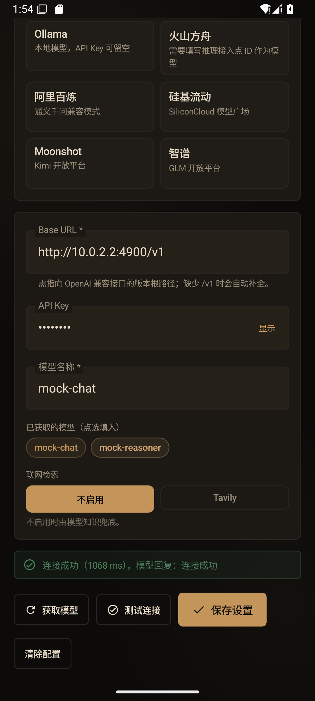
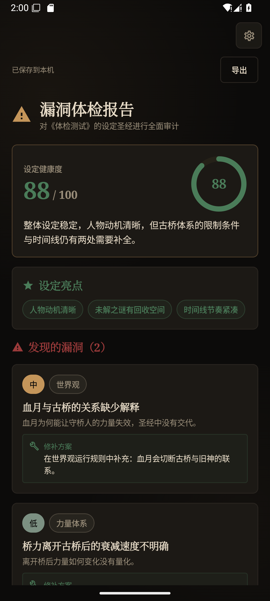
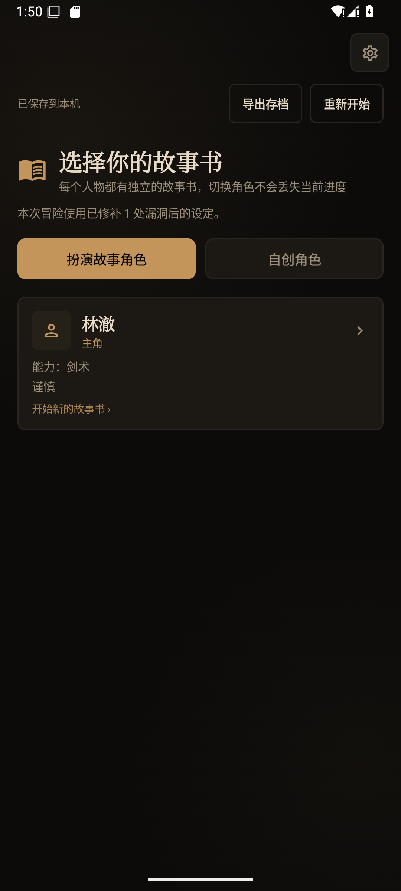
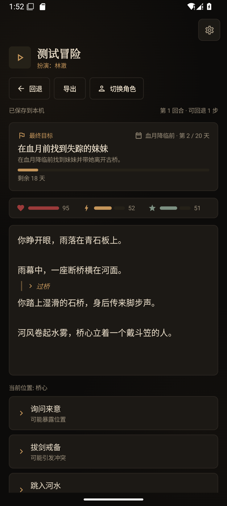
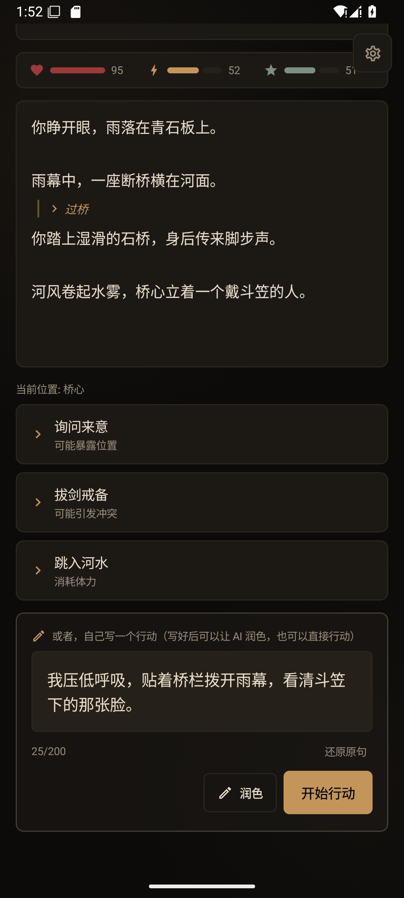
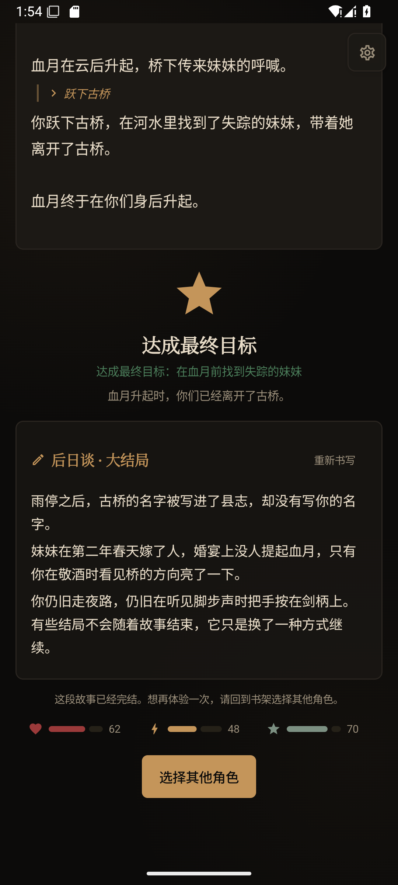
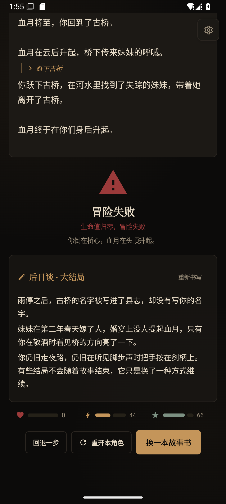

# 假如是你 · Android

> 输入一部小说，生成它的设定圣经，再以「你」为主角走进故事。

这是对原项目 [Character](https://github.com/vw0901/Character) 的安卓原生重构版。原项目（Next.js + FastAPI）保持原样，
本仓库是一套可以独立安装运行的 Android App：**Kotlin + Jetpack Compose + Material 3**，不依赖本机后端，
AI 请求由手机直接发往用户配置的 OpenAI 兼容服务。

仓库地址：<https://github.com/vw0901/Character_app>

- 应用名：**假如是你**
- 包名：`com.ifitwereyou.character`
- 版本：`1.0.0`（versionCode 1）
- 最低系统：Android 8.0（API 26）
- 目标 SDK：Android 15（API 35）
- APK：构建后位于 `app/build/outputs/apk/debug/app-debug.apk`，本仓库另附
  `dist/character_app-debug.apk`（debug 签名，可直接安装）

## 界面

以下截图来自 Android 15 模拟器，AI 响应由原项目自带的 `mock_openai_server.py` 提供，仅用于验证界面与流程。

| 首页 / 存档书架 | AI 设置 |
|---|---|
|  |  |

| 设定圣经 | 漏洞体检 |
|---|---|
|  |  |

| 选择故事书 | 文字冒险 |
|---|---|
|  |  |

| 自填行动与润色 | 成功结局 · 后日谈 |
|---|---|
|  |  |

失败结局同样会写后日谈，并保留「回退一步 / 重开本角色 / 换一本故事书」三个出口：



## 保留的操作流程

与原项目一致：**检索 → 设定圣经 → 漏洞体检 → 自动修补 → 选择角色 → 文字冒险 → 结局 → 后日谈**，
每一步都会自动保存，关掉 App 再回来可以继续。

| 原项目行为 | Android 版 |
|---|---|
| 输入小说名检索；可配置 Tavily，未配置时由模型知识兜底 | 保留；检索结果与摘要流程一致 |
| 流式生成设定圣经：世界观、力量体系、势力、人物、时间线、未解之谜 | 保留；同样支持宽松 JSON 解析与重试 |
| 漏洞体检评分、亮点、问题列表与修补方案 | 保留 |
| 体检后自动按报告修补圣经；失败可重试或跳过 | 保留 |
| 每个角色一本故事书；可扮演小说人物或自创角色 | 保留；自创角色的姓名/背景/能力/性格表单一致 |
| 一次行动推进一个场景，选项由模型生成 | 保留 |
| 自填行动 + AI 润色 + 还原原句；200 字上限 | 保留；安卓上通过按钮提交 |
| 打字机逐字显示；显示完才亮出选项；可「显示全文」 | 保留（18ms/字，开始延迟 120ms） |
| 最终目标、15–30 天时间线、生命/战力/声望 | 保留；所有数值收敛规则一致 |
| 每轮独立复核目标是否完成；判定失败有本地兜底 | 保留（20 秒超时，失败不阻塞剧情） |
| 成功/失败由前端规则裁定，不由模型单独决定 | 保留 |
| 最多 20 步快照回退；成功后不可回退 | 保留 |
| 结束后写 500–800 字后日谈，流式显示，写完才存档 | 保留；支持重新书写 |
| 失败可重开本角色；成功只能回书架换角色 | 保留 |
| 项目 JSON 自动保存、导入/导出、最近存档列表 | 保留；改用安卓 SAF 选择文件，格式完全兼容 |
| 多服务商预设：OpenAI/DeepSeek/Ollama/方舟/百炼/硅基流动/Moonshot/智谱 | 保留全部 8 个预设 |
| 获取模型列表、测试连接、保存/清除配置 | 保留 |
| 「墨香与炉火」暗色视觉、衬线标题、等宽冒险正文 | 保留设计语言，适配手机排版 |

## 构建

### 环境

- JDK 17
- Android SDK Platform 35
- Build-Tools 35.0.0
- 无需安装 Node.js / Python / FastAPI

### 命令行

```bash
cd character_app
./gradlew :app:assembleDebug
# Windows: gradlew.bat :app:assembleDebug
```

如果本机没有 `local.properties`，创建它并指向自己的 SDK：

```properties
sdk.dir=C\:\\path\\to\\Android\\Sdk
```

也可以直接用 Android Studio 打开 `character_app` 目录，等待 Gradle Sync 后运行 `app`。

`gradle/wrapper/gradle-wrapper.properties` 里使用了腾讯云 Gradle 镜像；如果网络条件允许，也可以换回
`https://services.gradle.org/distributions/gradle-8.9-bin.zip`。

### 安装

```bash
adb install -r app/build/outputs/apk/debug/app-debug.apk
```

## 第一次使用

1. 点右上角齿轮，进入 **AI 设置**。
2. 选择服务商预设，或填写任意 OpenAI 兼容接口的 **Base URL / API Key / 模型名**。
3. 可点「获取模型」拉取模型列表，点「测试连接」确认连通，再「保存设置」。
4. 回到首页，输入小说名（如《三体》）→ 检索 → 设定圣经 → 漏洞体检（自动修补）→ 开始冒险。
5. 选一个小说人物或自创角色；每轮先读剧情，再选选项，或自己写行动并让 AI 润色。

### 本机模型地址

- 手机上的 Ollama：`http://127.0.0.1:11434/v1`
- 电脑上的 Ollama，从 Android 模拟器访问：`http://10.0.2.2:11434/v1`
- 真机访问同一局域网电脑：填写电脑的局域网 IP，并确保 Ollama 监听 `0.0.0.0`

App 允许 HTTP 明文连接，便于本机/局域网模型；API Key 留空时会发送 `Bearer sk-local`，与原后端行为一致。

## 存档

- 每个项目保存为应用内部文件：`files/projects/<id>.json`。
- 写入使用临时文件替换，防抖 600ms；离开 App 前会再落盘一次。
- 文件格式与原项目完全一致：

```json
{
  "format": "if-it-were-you/project",
  "formatVersion": 2,
  "appVersion": "0.4.0",
  "id": "三体",
  "novelName": "三体",
  "search": {},
  "bible": {},
  "check": {},
  "repair": {},
  "adventures": {},
  "activeAdventureKey": null
}
```

- 项目文档里的 `appVersion` 仍写 `0.4.0`，以便与原项目互相导入；Android 应用自身版本是 `1.0.0`。
- 导出：设定圣经页、体检页、冒险页的「导出」会打开系统文件选择器，生成 `<小说名>-<日期>.json`。
- 导入：首页「导入 JSON 存档」支持三种结构——项目存档、设定圣经、检索结果；同名 ID 会覆盖本机同名存档。
- Android 内部存储对普通用户不可见；需要备份或跨设备迁移时使用导出/导入。
- 未提供删除存档入口，与原项目前端行为一致；最近存档在首页显示 6 条。

## 与原项目的差异

原项目是「浏览器前端 + 本机 FastAPI」；本版是「单机 Android App」，因此接口形态发生变化，但用户操作与数据含义保持一致：

| 方面 | 原项目 | Android 版 |
|---|---|---|
| UI | Next.js 16 + React 19 + Tailwind | Kotlin + Jetpack Compose + Material 3 |
| 后端 | FastAPI 代理 AI、检索与存档 | 无后端；App 直接请求 AI/Tavily |
| AI 配置 | 浏览器 `localStorage` | `SharedPreferences`（不参与备份） |
| 存档 | `backend/data/projects/*.json` | 应用内部 `files/projects/*.json` |
| 导入/导出 | `<input type=file>` / 浏览器下载 | 安卓 Storage Access Framework |
| 快捷键 | `Ctrl+Enter` 直接行动 | 「开始行动」按钮（触屏没有组合键） |
| 环境变量兜底 | 未配置时读 `backend/.env` | 没有 `.env`，必须先在 App 内保存配置 |
| 错误文案 | 后端映射 | 客户端映射，文案与判断规则保持一致 |
| 提示词 | `backend/app/ai/prompts/` | `ai/Prompts.kt`，逐段移植 |
| 服务商请求 | 后端统一发 | 手机直连；流式失败会回退非流式，`max_tokens` 被拒会自动去掉重试 |
| 目标判定/后日谈超时 | 前端 AbortController | 客户端 20s / 120s 超时，且使用 OkHttp call timeout |

## 代码结构

```
character_app/
├── app/src/main/java/com/ifitwereyou/character/
│   ├── MainActivity.kt              # 单 Activity、edge-to-edge
│   ├── ai/
│   │   ├── AiClient.kt              # OpenAI 兼容流式客户端、重试/降级
│   │   ├── Prompts.kt               # 全部阶段提示词与上下文压缩
│   │   ├── SearchService.kt         # Tavily 检索 + 模型兜底
│   │   ├── SettingsStore.kt         # 本机 AI 配置
│   │   ├── UrlTools.kt              # Base URL 规范化
│   │   └── AiErrors.kt              # 可读错误文案
│   ├── data/
│   │   ├── Models.kt                # 与原存档结构一致的领域模型
│   │   ├── ProjectCodec.kt          # 宽松解析、规范化、导入识别、JSON 编码
│   │   ├── ProjectStore.kt          # 原子写入、列表、路径校验
│   │   └── JsonSupport.kt           # 宽松 JSON 工具
│   ├── game/
│   │   ├── Rules.kt                 # 数值上限、行动天数、结局裁定、目标文本兜底
│   │   └── Adventure.kt             # 角色键、故事书创建、快照
│   └── ui/
│       ├── App.kt                   # 导航、SAF 启动器、全局设置入口
│       ├── AppViewModel.kt          # 搜索/生成/打卡/冒险/存档状态机
│       ├── UiState.kt
│       ├── components/Common.kt     # 按钮、卡片、状态条、评分环等
│       ├── screens/                 # 首页/圣经/体检/角色选择/冒险/设置
│       └── theme/Theme.kt           # 墨香与炉火配色、字体与圆角
├── app/src/test/                    # 54 项 JVM 单元测试
├── docs/screenshots/                # 模拟器验证截图
└── gradle/                          # Gradle Wrapper（8.9）
```

## 测试与验证

### 单元测试

```bash
./gradlew :app:testDebugUnitTest
```

覆盖 6 个测试类、共 **54 项**，全部通过：

- `UrlToolsTest`：Base URL 补 `/v1`、去端点后缀、非法 URL
- `RulesTest`：属性封顶、开局生命下限、天数、成功/死亡/超时/失败裁定、目标文本兜底、读档对账
- `ProjectCodecTest`：宽松 JSON、蛇形字段、圣经/体检/修补/开局/场景解析、旧存档迁移、导入识别、导出往返
- `ProjectStoreTest`：UTF-8 原子写入、列表排序、非法 ID、损坏文件容错
- `PromptsTest`：各阶段提示词、上下文摘要、历史截断、润色清洗
- `AiClientTest`：SSE 增量、非流式降级、401 不降级、模型列表、错误映射

### 模拟器实机验证

已在 Android 15（API 35）模拟器上安装运行，并用原项目的 `mock_openai_server.py` 验证：

1. 首页、AI 设置、获取模型、测试连接
2. 检索《三体》→ 设定圣经流式生成并自动保存
3. 漏洞体检 → 自动修补
4. 选择林澈 → 生成开场 → 选择「过桥」→ 属性/时间线推进
5. 自填行动 → AI 润色 → 还原 → 提交
6. 回退一步
7. 成功结局与自动后日谈；失败结局；从失败结局回退
8. 通过系统文件选择器导出 JSON，再从首页导入该文件

截图见 `docs/screenshots/`。

如果要复现这套验证，可启动原项目自带的 mock 服务：

```bash
cd ../character/backend
MOCK_PORT=4900 .venv/Scripts/python mock_openai_server.py   # macOS/Linux 用 .venv/bin/python
```

然后在 App 设置里填 `http://10.0.2.2:4900/v1`、模型 `mock-chat`、Key 任意非空值（模拟器访问宿主机）。

## 已知限制

- 提供的是 **debug APK**，使用 Android 默认调试签名；发布到应用商店需要自己的签名与 release 构建。
- AI Key 保存在本机 `SharedPreferences` 明文里，但 `android:allowBackup=false` 且不上传；共用设备请用「清除配置」。
- 手机直连服务商，受各自网络、地区与 CORS 以外的网络策略影响；流式不被支持时会自动回退非流式。
- 应用被系统杀死后，正在进行的请求会中断；已自动保存的进度不受影响。
- 未做平板/折叠屏专门布局；Compose 会随屏幕宽度换行。
- 未实现原项目后端提供的多用户/服务器同步；本版定位是单机离线存档 + 直连 AI。

## 原项目状态

本目录完全独立；同级 `character/` 未被修改。原项目仍可按其 README 用 `python start.py` 启动。
两边的项目 JSON 可以互相导入/导出。
