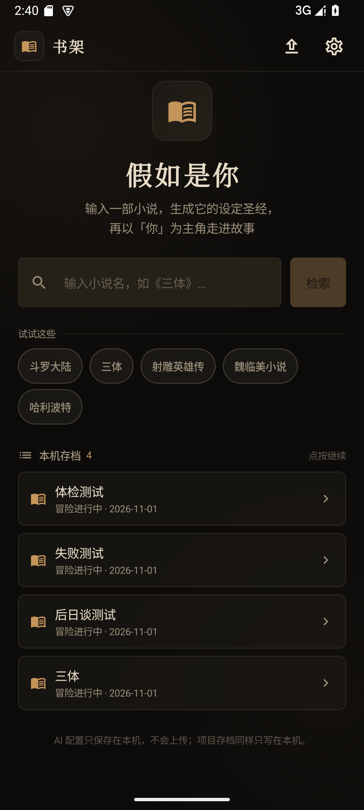
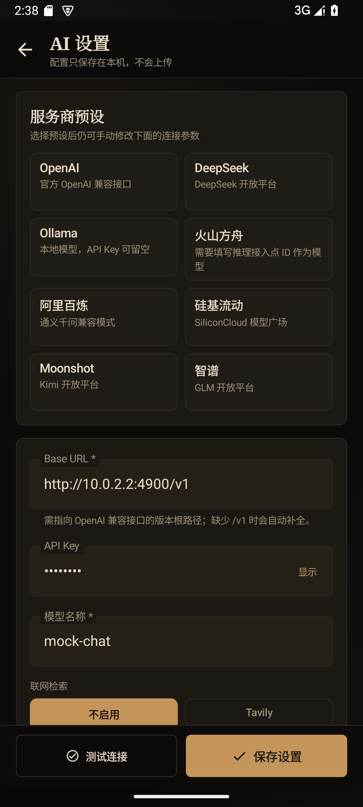
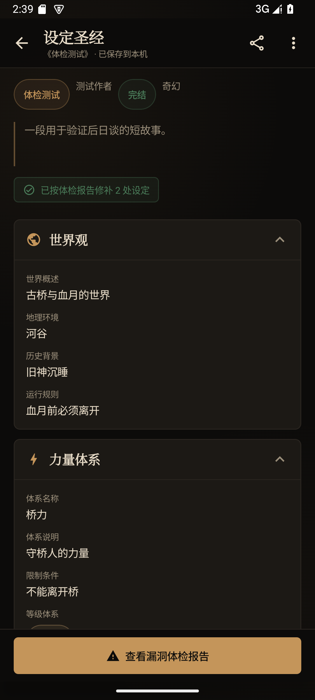
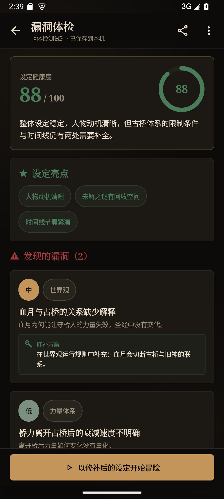
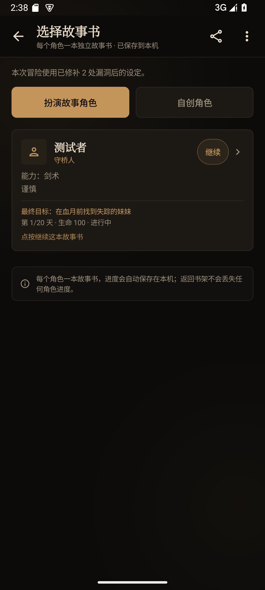
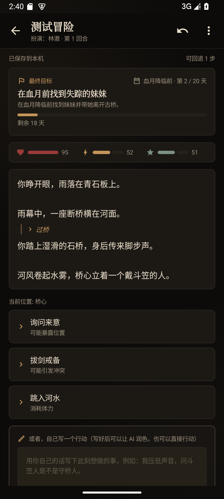
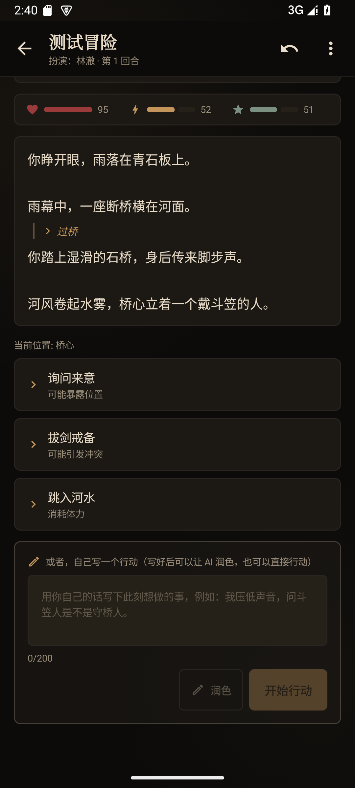
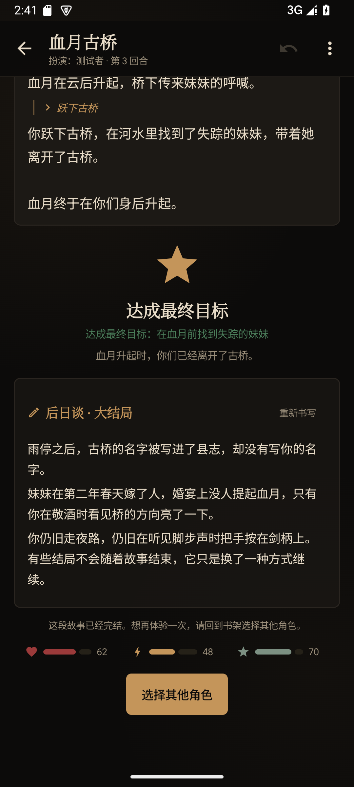

# 假如是你 · Android

> 输入一部小说，生成它的设定圣经，再以「你」为主角走进故事。

这是一个可以直接安装在手机上的单机文字冒险 App：**Kotlin + Jetpack Compose + Material 3**，
不需要本机后端，AI 请求由手机直接发往你配置的 OpenAI 兼容服务。

本项目是 [Character](https://github.com/vw0901/Character)（Next.js + FastAPI）的 Android 原生重制版，
操作流程与存档格式保持一致，原项目可以继续独立运行。

- 仓库地址：<https://github.com/vw0901/Character_app>
- 当前版本：**1.0.0**（versionCode 1）
- 包名：`com.ifitwereyou.character`
- 最低系统：Android 8.0（API 26）
- 目标 SDK：Android 15（API 35）
- 技术栈：Kotlin 2.x、Jetpack Compose、Material 3、OkHttp、Kotlin Coroutines
- 安装包：构建后位于 `app/build/outputs/apk/debug/app-debug.apk`

## 界面

截图来自 Android 15（API 35）模拟器，AI 响应由原项目自带的 `mock_openai_server.py` 提供，仅用于验证界面与流程。

| 书架 / 首页 | AI 设置 |
|---|---|
|  |  |

| 设定圣经 | 漏洞体检 |
|---|---|
|  |  |

| 选择故事书 | 文字冒险 |
|---|---|
|  |  |

| 自填行动与润色 | 成功结局 · 后日谈 |
|---|---|
|  |  |

## 这套 App 能做什么

完整保留原项目的创作流程：

**检索 → 设定圣经 → 漏洞体检 → 自动修补 → 选择角色 → 文字冒险 → 结局 → 后日谈**

- **检索小说**：输入书名，可选接入 Tavily；未配置联网检索时由模型知识兜底。
- **设定圣经**：流式生成世界观、力量体系、势力、人物、时间线和未解之谜，宽松解析 JSON 并自动重试。
- **漏洞体检**：给出健康度评分、亮点、问题列表和逐条修补方案，体检后自动把修补结果写回设定。
- **角色故事书**：每个角色一本独立故事书，可以扮演小说人物，也可以自创姓名、背景、能力和性格。
- **文字冒险**：每轮一个场景，选项由模型生成；显示最终目标、15–30 天时间线和生命 / 战力 / 声望。
- **自填行动**：最多 200 字，可让 AI 润色成小说句子，也可还原原句后直接提交。
- **结局判定**：成功 / 失败由客户端规则裁定，不交给模型单独决定；每轮独立复核目标，超时有本地兜底。
- **后日谈**：结束后流式书写 500–800 字后日谈，写完才存档，支持重新书写。
- **回退与重开**：最多保留 20 步快照；成功后不可回退；失败可以重开本角色或换一本故事书。
- **本地存档**：自动防抖保存、原子写入；支持导入 / 导出与原项目完全兼容的项目 JSON。
- **AI 配置**：内置 OpenAI、DeepSeek、Ollama、火山方舟、阿里百炼、硅基流动、Moonshot、智谱 8 个预设，
  也可以手工填写任意 OpenAI 兼容接口；支持拉取模型列表和测试连接。

### 面向手机的操作与视觉

1.0.0 对界面做了一轮手机化重构：

- **统一 App 顶栏**：返回键、页面标题、副标题和当前操作固定在上方，不再用悬浮齿轮遮挡内容。
- **主操作吸底**：「开始漏洞体检」「开始冒险」「保存设置」等下一步动作固定在底部，长页面也不用滑到底。
- **低频操作收进「更多」菜单**：导出、查看设定圣经 / 体检报告、切换角色、返回书架等不再挤占首屏。
- **移动端触控尺寸**：主按钮和图标按钮至少 48dp，选项卡片、角色卡片、标签都有完整的点按反馈。
- **触感反馈**：选择行动、选择角色时触发轻触感，降低误触和「没点上」的不确定感。
- **空态与引导**：没有存档时直接给出「导入 JSON 存档」入口；首次配置、故事书说明、角色进度提示都就地展示。
- **键盘与安全区适配**：edge-to-edge、`imePadding`、`safeDrawingPadding`，输入行动时界面不会被键盘挡住。
- **危险操作确认**：「清除配置」会先弹出确认框，避免误删 API Key。
- **墨香与炉火视觉**：深夜书房、旧皮革书封、烛火暖光和羊皮纸文字，衬线标题 + 等宽冒险正文继续保留。

## 快速开始

### 环境

- JDK 17
- Android SDK Platform 35
- Build-Tools 35.0.0
- Android Studio（推荐）或命令行 Gradle
- 不需要 Node.js / Python / FastAPI

### 构建

```bash
cd character_app

# Windows
gradlew.bat :app:assembleDebug

# macOS / Linux
./gradlew :app:assembleDebug
```

产物：`app/build/outputs/apk/debug/app-debug.apk`

如果本机没有 `local.properties`，创建它并指向自己的 SDK：

```properties
sdk.dir=C\:\\path\\to\\Android\\Sdk
```

也可以直接用 Android Studio 打开 `character_app`，等待 Gradle Sync 后运行 `app`。

`gradle/wrapper/gradle-wrapper.properties` 默认使用腾讯云 Gradle 镜像；网络条件允许时可以换回
`https://services.gradle.org/distributions/gradle-8.9-bin.zip`。

### 安装

```bash
adb install -r app/build/outputs/apk/debug/app-debug.apk
```

## 第一次使用

1. 点首页右上角齿轮，进入 **AI 设置**。
2. 选择服务商预设，或填写任意 OpenAI 兼容接口的 **Base URL / API Key / 模型名**。
3. 点「获取模型」拉取模型列表，点「测试连接」确认连通，再点底部「保存设置」。
4. 回到书架，输入小说名（如《三体》）→ 检索 → 生成设定圣经 → 漏洞体检（自动修补）→ 开始冒险。
5. 选一个小说人物或自创角色；每轮先读剧情，再选选项，或自己写行动交给 AI 润色。

### 本机模型地址

- 手机上的 Ollama：`http://127.0.0.1:11434/v1`
- 电脑上的 Ollama，从 Android 模拟器访问：`http://10.0.2.2:11434/v1`
- 真机访问同一局域网的电脑：填写电脑局域网 IP，并确保 Ollama 监听 `0.0.0.0`

App 允许 HTTP 明文连接，便于本机 / 局域网模型；API Key 留空时会发送 `Bearer sk-local`，与原后端行为一致。

## 存档与导入导出

- 每个项目保存为应用内部文件：`files/projects/<id>.json`。
- 写入使用临时文件替换，防抖 600ms；离开 App 前会再落盘一次。
- 文件名与项目格式和原项目兼容：

```json
{
  "format": "if-it-were-you/project",
  "formatVersion": 2,
  "appVersion": "0.4.0",
  "id": "三体",
  "novelName": "三体",
  "search": {},
  "bible": {},
  "check": {},
  "repair": {},
  "adventures": {},
  "activeAdventureKey": null
}
```

- 项目文档里的 `appVersion` 仍写 `0.4.0`，以便与原项目互相导入；Android 应用自身版本是 `1.0.0`。
- 导出：顶栏「分享」图标会打开系统文件选择器，生成 `<小说名>-<日期>.json`。
- 导入：书架右上角「导入」图标支持三种结构——项目存档、设定圣经、检索结果；同名 ID 会覆盖本机同名存档。
- Android 内部存储对普通用户不可见；需要备份或跨设备迁移时使用导出 / 导入。

## 与原项目的差异

| 方面 | 原项目 Character | 本项目 Character_app |
|---|---|---|
| UI | Next.js 16 + React 19 + Tailwind | Kotlin + Jetpack Compose + Material 3 |
| 后端 | FastAPI 代理 AI、检索与存档 | 无后端，App 直接请求 AI / Tavily |
| AI 配置 | 浏览器 `localStorage` | `SharedPreferences`（不参与备份） |
| 存档 | `backend/data/projects/*.json` | 应用内部 `files/projects/*.json` |
| 导入 / 导出 | `<input type=file>` / 浏览器下载 | Android Storage Access Framework |
| 快捷键 | `Ctrl+Enter` 直接行动 | 触屏按钮 + 输入法搜索键 |
| 环境变量兜底 | 读取 `backend/.env` | 没有 `.env`，必须先在 App 内保存配置 |
| 错误文案 | 后端映射 | 客户端映射，文案与判断规则保持一致 |
| 提示词 | `backend/app/ai/prompts/` | `ai/Prompts.kt`，逐段移植 |
| 服务商请求 | 后端统一发 | 手机直连；流式失败会回退非流式，`max_tokens` 被拒会自动去掉重试 |
| 目标判定 / 后日谈超时 | 前端 AbortController | 客户端 20s / 120s 超时，并使用 OkHttp call timeout |

## 项目结构

```text
character_app/
├── app/src/main/java/com/ifitwereyou/character/
│   ├── MainActivity.kt              # 单 Activity、edge-to-edge
│   ├── ai/
│   │   ├── AiClient.kt              # OpenAI 兼容流式客户端、重试/降级
│   │   ├── AiConfig.kt              # 服务商预设与本机配置读写
│   │   ├── AiErrors.kt              # 可读错误文案
│   │   ├── HttpSupport.kt           # OkHttp 基础配置
│   │   ├── Prompts.kt               # 全部阶段提示词与上下文压缩
│   │   ├── SearchService.kt         # Tavily 检索 + 模型兜底
│   │   └── UrlTools.kt              # Base URL 规范化
│   ├── data/
│   │   ├── JsonSupport.kt           # 宽松 JSON 工具
│   │   ├── Models.kt                # 领域模型与存档结构
│   │   ├── ProjectCodec.kt          # 解析、规范化、导入识别、编码
│   │   └── ProjectStore.kt          # 原子写入、列表、路径校验
│   ├── game/
│   │   ├── Adventure.kt             # 角色键、故事书创建、快照
│   │   └── Rules.kt                 # 数值上限、天数、结局裁定
│   └── ui/
│       ├── App.kt                   # 导航、SAF 启动器、Snackbar
│       ├── AppViewModel.kt          # 检索/生成/体检/冒险/存档状态机
│       ├── UiState.kt               # 页面状态
│       ├── components/Common.kt     # 顶栏、菜单、按钮、卡片、状态条、评分环
│       ├── screens/                 # 书架、圣经、体检、故事书、冒险、设置
│       └── theme/Theme.kt           # 墨香与炉火配色、字体与圆角
├── app/src/test/                    # 54 项 JVM 单元测试
├── docs/screenshots/                # Android 15 模拟器截图
└── gradle/                          # Gradle Wrapper（8.9）
```

## 测试与验证

### 单元测试

```bash
gradlew.bat :app:testDebugUnitTest
# macOS / Linux: ./gradlew :app:testDebugUnitTest
```

共 6 个测试类、**54 项**，全部通过：

- `UrlToolsTest`：Base URL 补 `/v1`、去端点后缀、非法 URL
- `RulesTest`：属性封顶、开局生命下限、天数、成功/死亡/超时/失败裁定、目标文本兜底、读档对账
- `ProjectCodecTest`：宽松 JSON、蛇形字段、圣经/体检/修补/开局/场景解析、旧存档迁移、导入识别、导出往返
- `ProjectStoreTest`：UTF-8 原子写入、列表排序、非法 ID、损坏文件容错
- `PromptsTest`：各阶段提示词、上下文摘要、历史截断、润色清洗
- `AiClientTest`：SSE 增量、非流式降级、401 不降级、模型列表、错误映射

### 模拟器实机验证

已在 Android 15（API 35）模拟器（1080×2400、density 420）上安装运行，并验证：

1. 书架、AI 设置、获取模型、测试连接、保存配置
2. 检索小说 → 设定圣经流式生成并自动保存
3. 漏洞体检 → 自动修补
4. 选择角色 → 生成开场 → 选择行动 → 属性 / 时间线推进
5. 自填行动 → AI 润色 → 还原 → 提交
6. 回退一步
7. 成功结局与自动后日谈；失败结局；从失败结局回退
8. 通过系统文件选择器导出 JSON，再从书架导入该文件

如果要复现 AI 相关流程，可启动原项目自带的 mock 服务：

```bash
cd ../character/backend
MOCK_PORT=4900 .venv/Scripts/python mock_openai_server.py   # macOS/Linux 用 .venv/bin/python
```

然后在 App 设置里填 `http://10.0.2.2:4900/v1`、模型 `mock-chat`、Key 任意非空值。

## 已知限制

- 提供的是 **debug APK**，使用 Android 默认调试签名；发布到应用商店需要自己的签名与 release 构建。
- AI Key 保存在本机 `SharedPreferences` 明文里，但 `android:allowBackup=false` 且不上传；共用设备请用「清除配置」。
- 手机直连服务商，受各自网络、地区与网络策略影响；流式不被支持时会自动回退非流式。
- 应用被系统杀死后，正在进行的请求会中断；已自动保存的进度不受影响。
- 暂未做平板 / 折叠屏专门布局，Compose 会随屏幕宽度换行。
- 暂未提供应用内删除存档入口；需要清理时请卸载应用或使用文件管理权限。
- 未实现原项目后端提供的多用户 / 服务器同步；本版定位是单机离线存档 + 直连 AI。

## 版本与发布

- **1.0.0**（versionCode 1）
- 当前为 Android 原生重制版的首个完整版本：完整流程、手机化界面、本地存档、导入导出与 54 项单测。
- 版本号在 `app/build.gradle.kts` 的 `defaultConfig` 中维护。

## 致谢

- 原项目：[vw0901/Character](https://github.com/vw0901/Character)
- 提示词、结局规则、存档结构与「墨香与炉火」设计语言均来自原项目。
- 本项目与原项目各自独立，两者导出的项目 JSON 可以互相导入。
